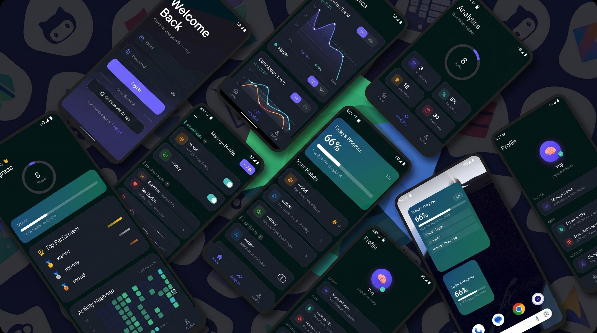
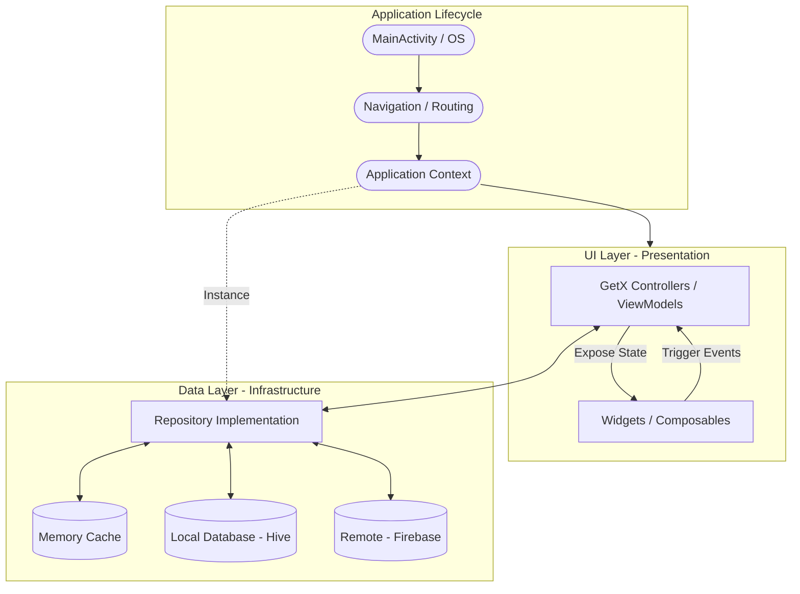
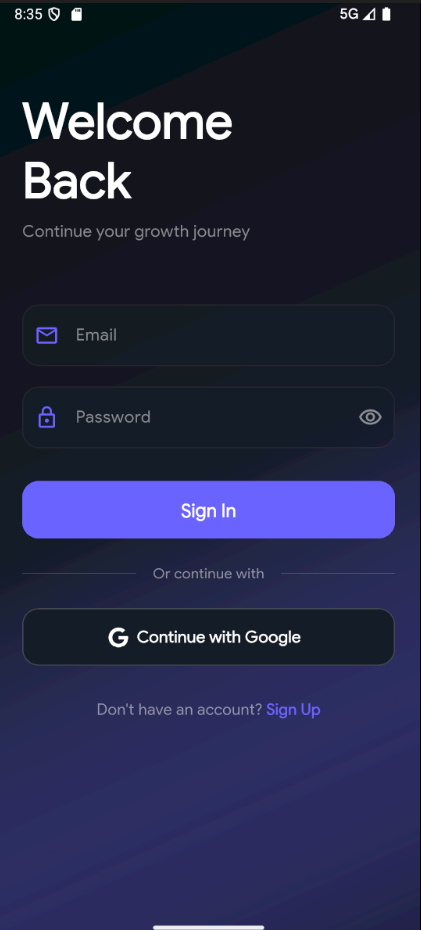
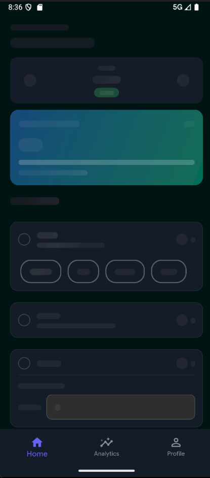
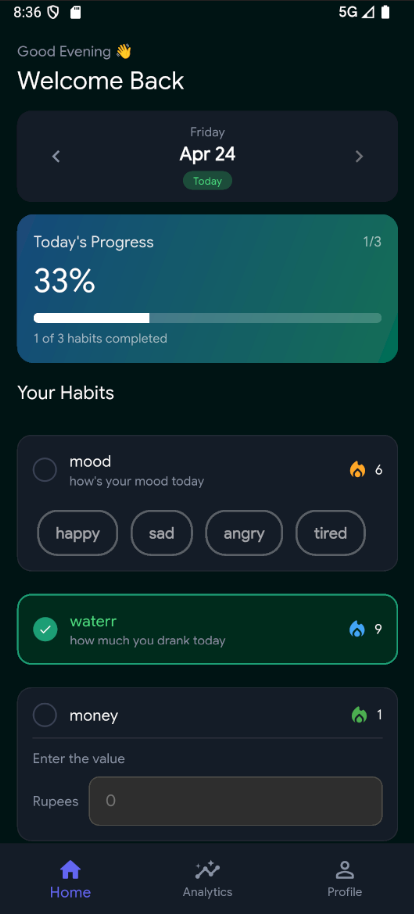
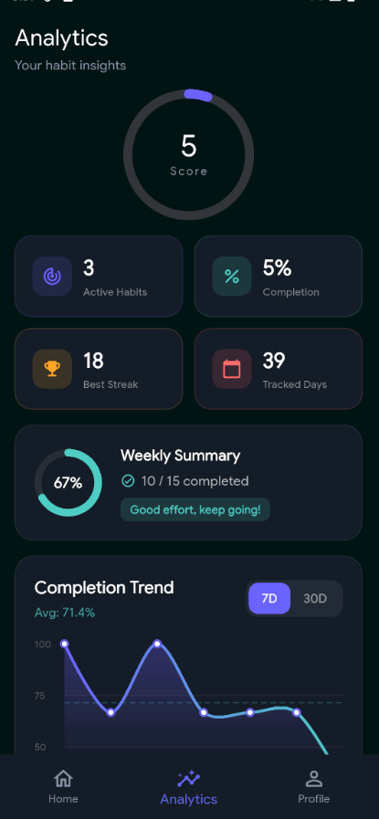
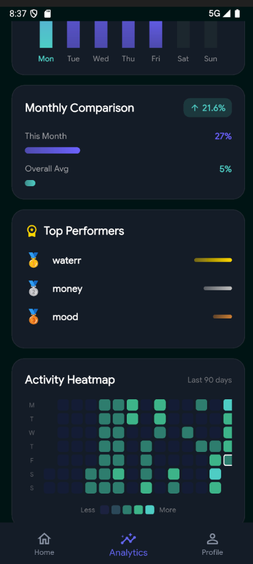
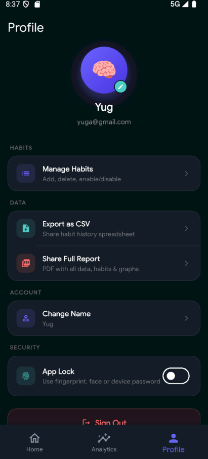
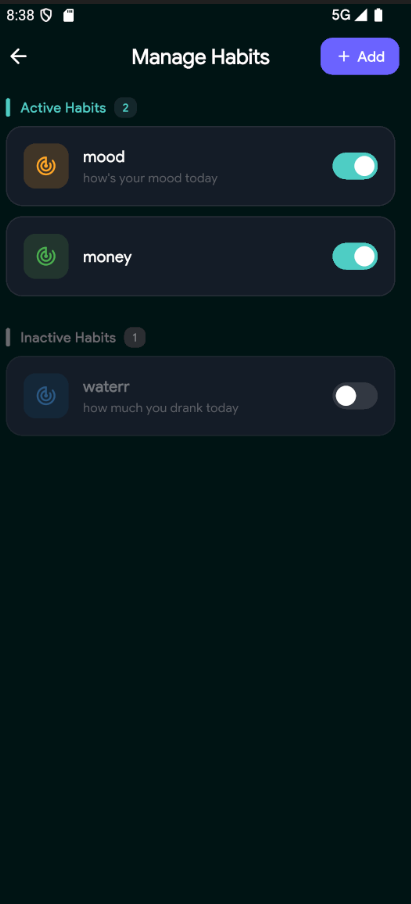
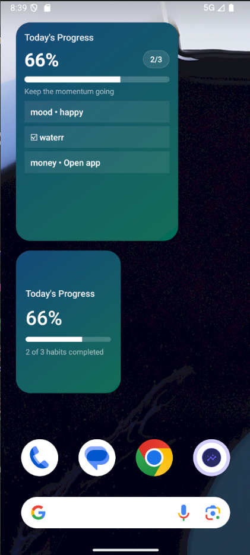

# Analyzer



A modern Flutter habit tracking app focused on daily consistency, progress visibility, and lightweight personal analytics.

Built with `GetX`, `Firebase`, `Hive`, and a clean layered structure, Personal Analyzer lets users create custom habits, log progress across days, review trends, export reports, and sync status to Android home-screen widgets.

## Overview

Personal Analyzer is designed around three core flows:

- Track habits daily with flexible input types
- Analyze consistency with streaks, trends, and heatmaps
- Manage data securely with Firebase auth, local caching, cloud synchronization, multi device synchronization and app lock

The app currently includes:

- Email/password authentication
- Google sign-in wiring
- Habit setup after registration
- Daily habit tracking by date
- Checklist, numeric, and option-based habits
- Analytics dashboard with weekly and long-term insights
- CSV and PDF export
- Biometric/device-lock app protection that re-locks after time in the background
- Android home-screen widgets with action sync
- Firestore offline persistence
- Per-user Firestore security rules

---

## Feature Highlights

### Authentication and onboarding

- Email/password registration and login
- Google sign-in integration path
- Splash-based session restore
- First-run habit setup flow after account creation
- Firebase-backed user profile storage

### Habit tracking

- Create custom habits with:
  - checklist type
  - numeric value type
  - option selector type
- Add descriptions, units, options, colors, and icons
- Enable or disable habits without deleting them
- Reorder habits
- Track entries by selected date, not just today

### Analytics and insights

- Overall completion score
- Current and best streaks
- Weekly completion summary
- 7-day and 30-day trend tracking
- Weekday performance breakdown
- Top-performing habits
- 365-day history aggregation
- 90-day heatmap view

### Profile and data tools

- Update display name
- Choose avatar emoji
- Enable biometric/device app lock (re-locks after 30 seconds in the background)
- Export habit history as CSV
- Export a branded multi-page PDF report (works offline; fonts are bundled)

### Security and privacy

- Firestore rules restrict every document to its owner and validate field types and sizes
- Local data (caches, widget data, exports) is tied to the signed-in account and wiped on sign-out or account switch
- App Lock is per account; if the device screen lock is removed, the lock screen offers sign-out instead of trapping the user
- Android backups are disabled so cached habit data never leaves the device
- CSV exports neutralise spreadsheet formulas in habit names (CSV injection)
- Debug logs carry error types only, never tokens, emails or habit content

### Android widget support

- Small, medium, and large widgets
- Widget-driven habit interactions
- Pending widget actions synced back into Flutter state
- Midnight reset scheduling and refresh support

## Architecture

### Architecture Overview



### Layer Responsibilities

- **UI Layer (Presentation)**:
  - **Widgets**: Reusable UI components (Composables) that react to state changes.
  - **Controllers**: GetX Controllers acting as ViewModels, managing UI state and interacting with repositories.
- **Data Layer (Infrastructure)**:
  - **Repository**: The single source of truth for the UI. It orchestrates data flow between local and remote sources.
  - **Remote**: Firebase Auth and Cloud Firestore for cloud-based persistence.
  - **Database**: Hive for fast, offline-first local storage.
  - **Cache**: In-memory caching for performance-critical data (like analytics aggregations).
- **Domain Layer**: Defines entities and repository interfaces (contracts) that describe _what_ the app does without knowing _how_ data is fetched.
- **Core Layer**: Application-wide utilities, theme definitions, and dependency injection bindings.

## Project Structure

```text
lib/
├── core/
│   ├── bindings/
│   ├── errors/
│   ├── routes/
│   ├── theme/
│   └── utils/
├── data/
│   ├── cache/
│   ├── models/
│   ├── repositories/
│   └── services/
├── domain/
│   ├── entities/
│   ├── repositories/
│   └── usecases/
├── presentation/
│   ├── controllers/
│   ├── screens/
│   ├── services/
│   └── widgets/
├── firebase_options.dart
└── main.dart
```

## Data Model

Firestore uses a user-scoped structure. Only the owner can read or write their
documents, and [`firestore.rules`](firestore.rules) rejects any field not listed
below. Dates are Firestore timestamps.

### `users/{userId}`

Stores the profile:

```json
{
  "email": "user@example.com",
  "name": "John Doe",
  "createdAt": "<timestamp>"
}
```

### `users/{userId}/parameters/{parameterId}`

Stores habit definitions:

```json
{
  "name": "Read",
  "description": "20 pages a day",
  "type": "checklist | value | optionSelector",
  "order": 1,
  "isActive": true,
  "options": ["Good", "Okay", "Bad"],
  "unit": "pages",
  "icon": "book",
  "color": 4285290495,
  "createdAt": "<timestamp>"
}
```

### `users/{userId}/entries/{entryId}`

Stores daily habit logs. `value` is `true` for checklists, a number for value
habits, or the chosen option:

```json
{
  "parameterId": "<parameterId>",
  "date": "<timestamp>",
  "value": true,
  "notes": "Optional note",
  "createdAt": "<timestamp>"
}
```

### `users/{userId}/streaks/{parameterId}`

Stores streak state per habit:

```json
{
  "currentStreak": 4,
  "bestStreak": 12,
  "lastCompletedDate": "<timestamp>",
  "updatedAt": "<timestamp>"
}
```

> Adding a Firestore field? Add it to the matching `hasOnly([...])` list in
> `firestore.rules` too, or writes will be denied.

### Local storage

All of it is scoped to the signed-in account by `UserSessionStorage` and cleared
on sign-out or when a different account signs in.

- `Hive`: analytics cache, streak cache, and session metadata (owning account)
- `SharedPreferences`: avatar emoji, cached display name, and the per-account App Lock setting
- Temporary files: the most recent CSV/PDF export, replaced on each export

## Current Roadmap v0.1.0

- [x] Initialize core architecture with Firebase Auth, Cloud Firestore, and Hive local caching.
- [x] Implement secure authentication with Email/Password and Google Sign-In integration.
- [x] Develop dynamic habit management for custom types (Checklist, Numeric, Option Selector).
- [x] Build reactive Analytics dashboard with streaks, trends, and 90-day activity heatmaps.
- [x] Implement biometric and device-lock protection for enhanced privacy.
- [x] Create data export tools for CSV history and branded PDF reports.
- [x] Develop native Android home-screen widgets with action sync and midnight reset scheduling.
- [x] Optimize state management and caching for smooth UI transitions and offline-first performance.
- [x] Security and stability hardening: Firestore rules, account-scoped local data, release signing, strict lints.
- [ ] Create store publishing assets, banners, and privacy policy documentation.
- [ ] Enhance offline handling and network resilience for edge-case sync scenarios.
- [ ] Implement multi-language support.
- [ ] Add each habit analytic screen
- [ ] Add widget for iOS
- [ ] Add notification management to send reminders for each habit

## App Previews

|                             Login                             |                               Home (Loading)                                |                            Home                             |                                Analytics 1                                |
| :-----------------------------------------------------------: | :-------------------------------------------------------------------------: | :---------------------------------------------------------: | :-----------------------------------------------------------------------: |
|  |  |  |  |

|                                Analytics 2                                |                              Profile                              |                                 Manage Habits                                 |                             Widget                              |
| :-----------------------------------------------------------------------: | :---------------------------------------------------------------: | :---------------------------------------------------------------------------: | :-------------------------------------------------------------: |
|  |  |  |  |

## Installation

```bash
git clone https://github.com/YugaJ7/Analyzer.git
cd Analyzer
flutter pub get
flutter run
```

### Firebase setup

1. Add your own `android/app/google-services.json` (and, for iOS,
   `ios/Runner/GoogleService-Info.plist`), or run `flutterfire configure`.
2. Register your debug and release SHA-1/SHA-256 fingerprints in Firebase
   (`cd android && ./gradlew signingReport`) so Google Sign-In works.
3. Deploy the security rules:
   ```bash
   firebase deploy --only firestore:rules
   ```

### Tests and analysis

```bash
flutter analyze   # strict lints; must be clean
flutter test
```

---

## Build & Deploy

### Android

Debug builds need no setup:

```bash
flutter build apk --debug
```

Release builds are signed with an upload keystore and fail fast without one:

1. Create a keystore (keep it and its passwords safe; you can't publish updates without them):
   ```bash
   keytool -genkey -v -keystore android/upload-keystore.jks -keyalg RSA -keysize 2048 -validity 10000 -alias upload
   ```
2. Copy `android/key.properties.example` to `android/key.properties` and fill in the passwords.
   Both files are git-ignored.
3. Build:
   ```bash
   flutter build apk --release --split-per-abi
   # or, for Play Store
   flutter build appbundle --release
   ```

### iOS

Google Sign-In on iOS needs an iOS OAuth client in Firebase and its reversed
client ID added as a URL scheme in `ios/Runner/Info.plist`.

```bash
flutter build ios --release
```

## Contributions & Credits

This project is developed and maintained by [Yuga Jaiswal](https://github.com/YugaJ7).  
Feel free to fork, contribute, or give feedback!

---

## Feedback

If you have any ideas, feature requests, or spot a bug, feel free to open an issue or connect via [LinkedIn](https://linkedin.com/in/yuga-jaiswal).
